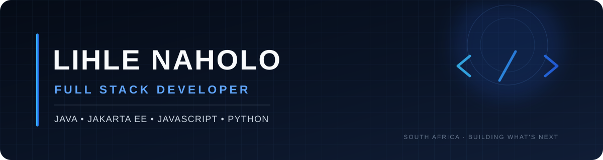

 

# Hey there 👋, I'm Lihle Naholo

### Computer Science Student · South Africa · Aspiring Full Stack Developer

Passionate about software development, modern web applications, Java development, and creating beautiful user experiences.

 

---

## 👨‍💻 About Me

- 🎓 Computer Science student from South Africa
- 🌱 Learning **Java, Jakarta EE, JavaScript, and Python**
- 🚀 Interested in **Full Stack Development**
- 🎨 Interested in **UI/UX design** and creating intuitive digital experiences
- 🖌️ I also use **Canva** for graphic design, visual content, and other creative projects
- 🛠️ Currently building **web applications and portfolio projects**

---

## 🧰 Tech Stack

---

## ✨ Featured Projects

| Project | About |
| --- | --- |
| 📱 **[MobileTrade Platform](https://github.com/lihlegotnorizz/MobileTrade)** | A customer-to-customer marketplace concept for buying, trading, and upgrading pre-loved phones. |
| 🌐 **[Personal Portfolio Website](https://lihlegotnorizz.github.io/lihle-digital-cv/)** | My digital CV and portfolio, showcasing my background, skills, and project work. |
| 🎓 **Student Management System** | A student-focused project. Repository link coming soon. |

---

## 📊 GitHub Statistics

 

---

### 💙 Thanks for stopping by!

*Always learning, building, and growing — one project at a time.*

